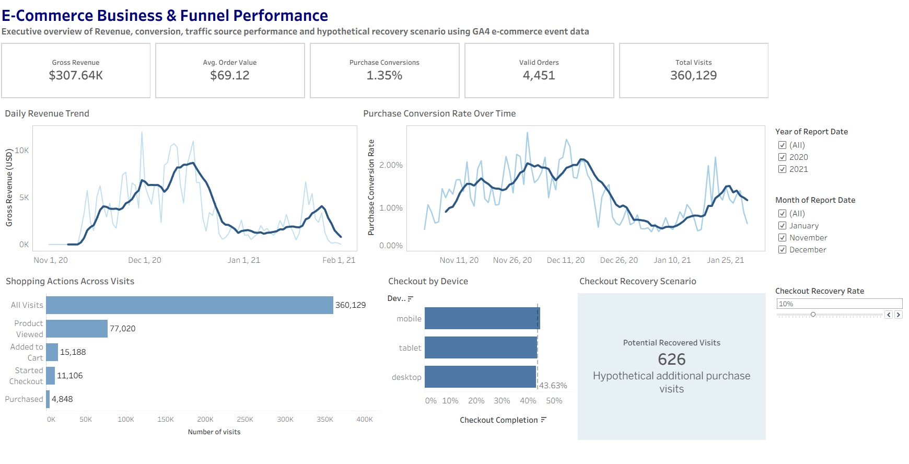
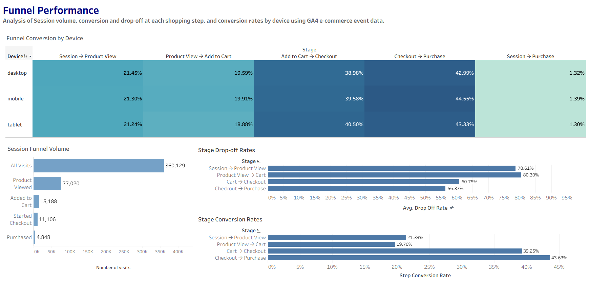
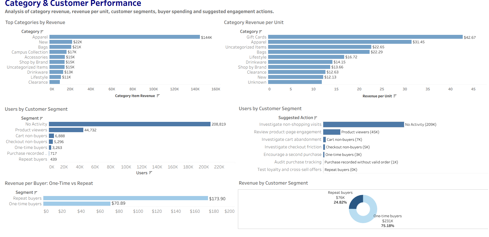

# GA4 E-Commerce Analytics

Analyzed 360,129 GA4 sessions with BigQuery SQL and built three Tableau dashboards to track business performance, compare product categories and customer segments, and identify where shoppers stopped progressing toward a purchase.

## Business Question

Where should an e-commerce team investigate conversion losses first? This project examines how shoppers interact with products, how often checkout sessions include a purchase, and which categories and buyer groups contribute revenue.

## Data and Tools

- **Dataset:** Google Analytics 4 public e-commerce sample in BigQuery
- **Period:** November 1, 2020 to January 31, 2021
- **BigQuery SQL:** Built a session-level table, calculated funnel metrics, and exported dashboard summaries
- **Tableau:** Built three dashboards for business, category and customer, and funnel analysis

## Key Findings

| Metric | Result |
|---|---:|
| Total sessions | 360,129 |
| Sessions with a product view | 77,020 |
| Sessions with a recorded purchase | 4,848 |
| Overall session-to-purchase rate | 1.35% |
| Sessions that started checkout | 11,106 |
| Checkout sessions without a recorded purchase | 6,261 |
| Checkout drop-off rate | 56.37% |

**Checkout was the clearest late-stage opportunity.** Of the 11,106 sessions that started checkout, 6,261 had no recorded purchase in the same visit. Completion rates were 42.99% on desktop, 44.55% on mobile, and 43.33% on tablet.

**Product engagement was another opportunity.** Of sessions that recorded a product view, 80.30% had no recorded add-to-cart event during the same visit.

## Tableau Dashboards

### 1. E-Commerce Business & Funnel Performance

An overview of revenue, orders, conversion trends, and traffic performance. It includes a hypothetical checkout recovery scenario for exploring how different recovery assumptions affect the number of purchase sessions.

### 2. E-Commerce Category & Customer Performance

Compares revenue and revenue per unit across categories, then shows customer segment sizes, revenue share, and spending per buyer.

### 3. E-Commerce Funnel Performance

Shows session volume at each shopping stage, step conversion and drop-off rates, and a device-level conversion comparison.

## Recommendations

1. **Review checkout first.** Walk through shipping-cost visibility, form errors, and payment steps. Start with desktop and mobile and use checkout volume and the number of incomplete checkouts to decide where to focus.
2. **Review product pages next.** Check whether pricing, availability, and the add-to-cart button are easy to find and use. Break down the product-view-to-cart rate by category in a follow-up analysis to narrow the investigation.
3. **Investigate a second-purchase campaign.** One-time buyers generated 75.18% of recorded buyer revenue in this analysis. Review what these customers bought and when they might be ready to purchase again before choosing an offer or message.

## How the Metrics Were Built

**GA4 events → BigQuery session table → summary CSVs → Tableau dashboards**

- **Session volume:** Counts sessions that recorded each shopping event.
- **Step conversion:** Among sessions that recorded the starting event, measures the share that also recorded the next event during the same visit.
- **Step drop-off:** Among those same starting sessions, measures the share without the next event.
- **Scope:** The funnel checks which events occurred in the same session. It does not verify their timestamp order. The findings identify areas to investigate, and the recovery scenario is hypothetical.

## Repository Contents

| Path | Contents |
|---|---|
| `sql/` | BigQuery queries used to prepare and summarize the GA4 data |
| `data/` | Summary CSVs used in Tableau |
| `dashboards/` | Screenshots of the three finished dashboards |
